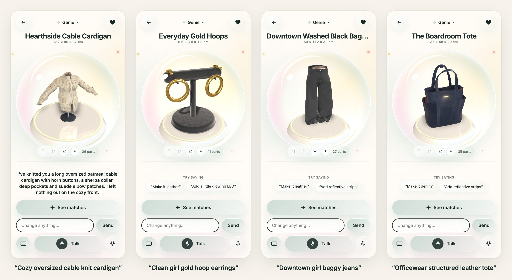
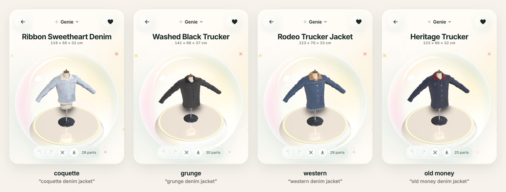
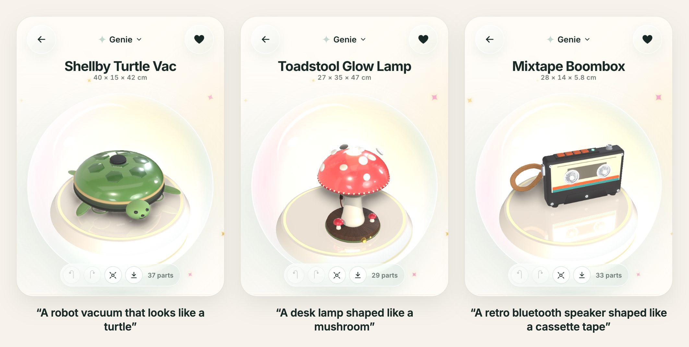
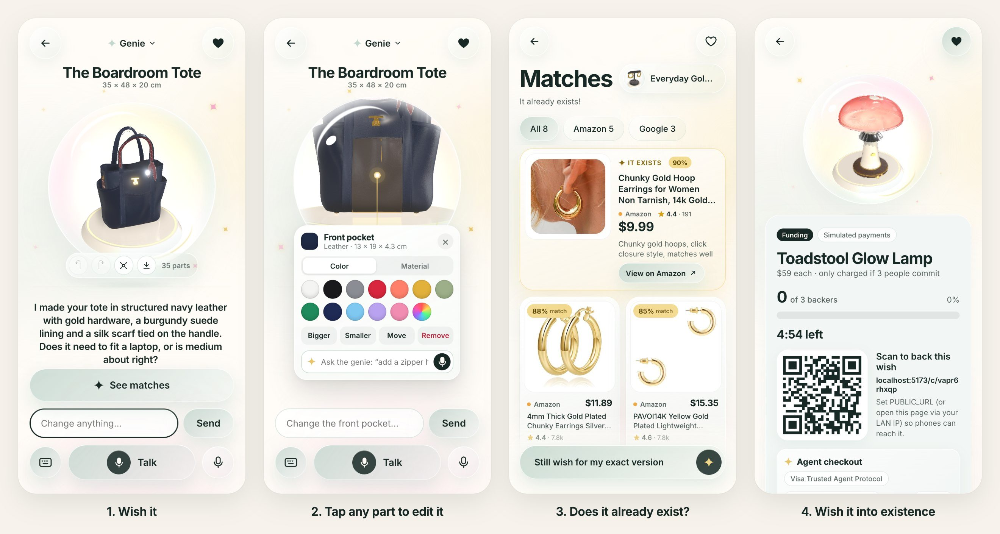
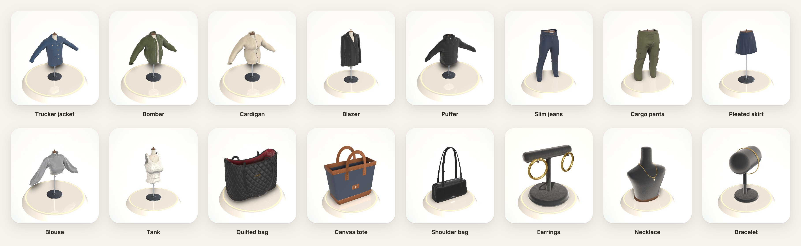

# ✦ Wish it

**Shop for products that don't exist yet, and only pay if they get made.**

Say what you wish you could buy ("a cozy oversized cable knit cardigan", "a desk lamp shaped like a mushroom"). A genie builds it in 3D while you talk, takes edits by voice or by tapping any part, and then checks whether it already exists on Amazon and Google Shopping. If nobody makes it, the wish becomes a campaign: backers scan a QR code and place a **card hold**. When enough people commit, every hold is captured and a purchase order goes to a maker. If the deadline passes first, every hold is released and nobody pays.

Built at Cal Hacks 13.0 for the Visa (Reimagining Shopping), Apify and Cartesia tracks.



## What it does

**Wish out loud, watch it appear.** The genie builds a real product from parts, with correct dimensions, real hardware and textured materials. A fashion wish puts a matching template on screen in about half a second, and Claude finishes the design in about 2.5 seconds, streaming in each change as it is decided.

**Aesthetic words actually mean something.** "Coquette", "grunge", "western" and "old money" each map to concrete design choices: fabrics, palette, hardware finish, signature details and things to avoid. Here is the same denim jacket wish in four aesthetics:



**Not just fashion.** With no matching template, the genie designs from scratch. A planner lays out the part groups, and builder calls stream them in parallel. The first parts appear in about 1.5 seconds and the design is finished in about 6.



**Tap, ask, compare, commit.**

1. **Tap any part to edit it.** The genie card shows the part's real size, swatches and materials, and takes requests like "add a little bow here", placed exactly where you tapped.
2. **Instant edits.** "Make it navy", "a bit longer", "show me the back" and "undo" apply in under a frame, with no network round trip.
3. **Check whether it exists.** Wish it searches Amazon and Google Shopping, and Claude scores every listing against your design and says what each one is missing.
4. **Wish it into existence.** Launch a campaign with card holds. The genie can even back it for you as a [Visa Trusted Agent Protocol](https://developer.visa.com/docs/trusted-agent-protocol/trusted-agent-protocol-specifications) agent.



**Wish World.** If nothing matches, "Can't find it?" flies your bubble into a field of past wishes nobody has made yet. Pan and zoom around it, hover a bubble for its votes, click it for the details, and up- or downvote. **Organize** lines the bubbles up by popularity. Your own bubble launches the campaign.

**Purchase without leaving the app.** Each match card has a Purchase button: confirm the price and the genie buys it as a Visa Trusted Agent Protocol agent. It signs the checkout under a one-listing, ten-minute mandate, and the merchant side verifies the signature, the payment container and the mandate. The listing and price come from the server's own search results. Wish it isn't the store, so these are test-mode orders: no real Amazon or Google checkout happens and no card is charged.

**UI variation 2 (the default).** A "Want it? Wish it." intro, a 3D glass bubble, type-anywhere input and a cleaner editor. Presenter keys (anywhere outside a text field): `1` starts a fresh wish with no intro, `2` toggles the classic UI and back, `3` starts a fresh wish with the intro holding on its title until you click, `4` opens the Wish World. `?ui=1` / `?ui=2` / `?ui=3` work in links.

**27 fashion templates**, each with controls (length, fit, leg shape, rise, sleeves, and more), material slots and named zones where detail modules attach, plus 27 hand-built product templates (backpacks, sneakers, lamps, speakers, helmets…):



## How it works

```
browser (studio) ──audio──> Cartesia (Ink 2 STT with turn detection, Sonic TTS)
   │  instant: classifier → template → style compiler → parts on screen (no network)
   │  REST + Socket.IO
   ▼
Node server (Express, Socket.IO, SQLite)
   ├──> Claude: streamed tool calls (plan_design / add_parts / style_outfit / apply_patches)
   ├──> Apify: Google Shopping + Amazon scrapers in parallel → Claude scores each listing
   └──> Stripe test mode: manual-capture card holds, webhooks
   ▼
browser (phone pledge page) ──card──> Stripe Payment Element    genie checkout ──> Visa TAP (RFC 9421)
```

- **Products are data, not meshes.** A product is a flat map of typed `Part`s (zod schemas) with parent links. Every change, from the user, the fast path or Claude, is a `Patch` (`add` / `update` / `remove`) validated by one `applyPatches` shared by client and server. Undo/redo comes free: one zundo snapshot per edit or per genie turn.
- **Instant first, smart second.** A local classifier reads the wish on every keystroke, picks a template and resolves aesthetics. A deterministic style compiler then builds a complete design before Claude is even called. Claude refines it from there, so the screen is never blank.
- **Streaming Claude, patch by patch.** Opus 5.5 in fast mode designs, Sonnet 5 (thinking off) edits, and Haiku 4.5 is the automatic fallback. Tool input streams with `eager_input_streaming`, a JSON scanner pulls out each patch the moment it closes, and every patch renders on arrival. The 55k-token system prompt (rules, schema, kit catalog, templates, aesthetics, worked examples) is prompt-cached and pre-warmed at boot, so each turn pays full price only for the conversation and the output.
- **Real garments, parametric control.** The fashion templates sit on CC-BY 3D scans, prepared headlessly in Blender (`tools/prep-garments`):
  - split into pattern pieces by UV islands and expression rules;
  - optionally warped and cleaned of baked details;
  - baked fold normal maps;
  - meshopt-compressed to about 10–60k triangles.

  Smooth deformers (length, sleeves, leg taper, rise, flare, fit) run per vertex in the renderer and on every zone point, so pockets, buttons and stitching stay glued to the garment as it changes shape.
- **A detail kit.** 97 parametric kit parts, including 61 detail modules: pockets, closures, trims, topstitching, labels, jewelry and bag hardware. Modules attach to named zones (points, lines, rings and curved paths), and the 21 aesthetics in `styles.json` merge with first-style-wins precedence.
- **Rendering.** React Three Fiber with `MeshPhysicalMaterial`:
  - 39 material presets over CC0 PBR textures;
  - fold maps layered over tiling weave normals through shader injection;
  - procedural geometry (lathes, swept straps, beveled extrusions) and CSG cutouts with three-bvh-csg;
  - bloom, a reflective pedestal, spring pop-in per part and `.glb` export for makers.
- **Matching.** The store search starts while the genie is still designing: as soon as Claude writes the product's title and description, before the 3D model is built. Each query runs as its own Apify scraper run, so they run in parallel, at most 5 at once (the plan limit) with a hard cutoff. Claude scores every listing from 0 to 100 against the spec, and results stream into the grid. By the time you tap "See matches", results are usually already there. Searches are keyed by what the product is, not its color, and reused for 30 minutes.
- **Commitment payments.**
  - Pledges are Stripe PaymentIntents with `capture_method: "manual"` and count only once the hold is confirmed.
  - When holds reach the target, one SQLite transaction flips the campaign to `capturing`, so exactly one caller captures (idempotency keys `capture-<pledgeId>`). If the deadline wins, every hold is canceled.
  - Campaigns are capped at 6 days, inside the 7-day hold window.

### Latency (measured)

| Path | Time |
| --- | --- |
| Fast-path edit ("make it red", "bigger", "show me the back", undo, swatches, gizmo) | instant, no network |
| Fashion wish | template on screen ~0.5 s; Claude's styled design complete ~2.5–3 s |
| Edit through the genie | first patch ~1–2 s, done ~2.5–3.5 s |
| Brand-new design (no template) | first part ~1.1–1.7 s, complete ~5–6 s (planner + parallel builders) |
| "See matches" | results on screen in under 5 s (the search started during the design) |

Opus 5.5 fast mode streams at about 290 tokens/s, compared with about 140 for Haiku 4.5 and 120 for Sonnet 5, so it is both the fastest and the best choice for long designs. Edits are short, so Sonnet 5's quicker first token wins there. Add `?debug` to the studio URL for per-turn timings: speech end → request → first patch → last patch → first audio.

### Agent checkout: Visa Trusted Agent Protocol

"Genie, back it for me" lets the genie pledge on the shopper's behalf, within a spending limit:

- **Mandate.** The limit becomes a mandate: a cap, this campaign only, expiring at the deadline.
- **Signed request.** The genie signs its checkout with RFC 9421 HTTP Message Signatures (Ed25519, `tag="agent-payer-auth"`, covering `@authority`, `@path` and `content-digest`). The body carries a signed `agenticPaymentContainer`.
- **Merchant checks.** Wish it, as the merchant, checks the tag, required fields, timestamps, nonce replay, the registered key, the body digest, the signature, the container and the mandate, all shown live in a trust log.
- **Attacks to try.** "Try to fool the merchant" sends an unsigned bot, a replayed request, an amount edited in flight, an expired signature and an over-limit request. Each is refused at the step that catches it, and none places a hold.

The signatures and verification are real TAP. Visa Intelligent Commerce (agentic tokens, Visa's key directory) is open to approved partners only, so the key registry and mandate live in Wish it, and the hold uses a Stripe test card. Code is in `server/src/tap.ts`, `server/src/agent.ts` and `web/src/ui/AgentCheckout.tsx`.

## Run it yourself

You need **Node 20+** (22 recommended) and npm. Every API key is optional: anything you leave out falls back, so the whole flow runs offline.

```bash
git clone https://github.com/kickswbrian/calhacks13.0.git wish-it && cd wish-it
npm install
cp .env.example .env   # add any keys you have (see below)
npm run dev            # API on :3000, web on :5173
```

Open **http://localhost:5173**, tap **Talk** (or the keyboard icon), and try "clean girl gold hoop earrings" or "a robot vacuum that looks like a turtle".

| Key in `.env` | Get it from | Unlocks | Without it |
| --- | --- | --- | --- |
| `ANTHROPIC_API_KEY` | [console.anthropic.com](https://console.anthropic.com) | The genie: Claude designs, edits and listing scores | Templates, the style compiler and instant edits only |
| `CARTESIA_API_KEY` | [play.cartesia.ai](https://play.cartesia.ai) | Ink 2 speech-to-text and Sonic voice replies | Browser speech APIs and the text box |
| `APIFY_TOKEN` | [console.apify.com](https://console.apify.com) | Live Amazon and Google Shopping matches | Clearly labelled sample listings |
| `STRIPE_SECRET_KEY`, `STRIPE_PUBLISHABLE_KEY` | Stripe dashboard (test mode) | Real card holds | A simulated provider that accepts the same test cards |

Optional settings:
- **Models:** `DESIGN_MODEL`, `EDIT_MODEL`, `FALLBACK_MODEL`, `FAST_MODE`.
- **Daily caps on paid calls:** `DAILY_LLM_TURNS`, `DAILY_APIFY_SEARCHES`, `DAILY_CARTESIA_TOKENS`.
- **Search ahead:** `SEARCH_AHEAD=0` only plans the search during the design and starts it when you tap "See matches".
- **Matching through the Actor:** `MATCH_VIA_ACTOR=1` with `APIFY_ACTOR=<you>~wish-matcher`. This routes matching through the bundled Actor instead of calling the scrapers directly. Deploy it with `cd actor && apify push`; see [actor/README.md](actor/README.md).

**Test cards:**
- `4242 4242 4242 4242` succeeds.
- `4000 0000 0000 0002` is declined.
- `4000 0000 0000 9995` fails for insufficient funds.

**Stripe webhooks locally:** run `stripe listen --forward-to localhost:3000/api/stripe/webhook` and put the printed `whsec_…` in `STRIPE_WEBHOOK_SECRET`. Without it, the pledge page polls Stripe every 3 s instead.

**Pledging from a phone:** the campaign QR code points at `PUBLIC_URL`. Set it to an HTTPS address phones can reach; the mic also needs HTTPS. For example, a tunnel such as `cloudflared tunnel --url http://localhost:3000` in front of the production server.

### Useful commands

```bash
npm test                 # shared + server tests (patches, fashion compiler, styles, stream parser, TAP)
npm run typecheck        # shared + server + web
npm run brain:test       # genie latency bench; results in web/public/bench/*.json
npm run demo:reset -- --planter-deadline=120   # demo starting state (server running)
npm run world:seed       # refresh the Wish World demo wishes and votes (also runs on startup when empty)
npm run build && npm start                     # production: one process serves API + web
```

| Route | What |
| --- | --- |
| `/` | The studio: wish, edit, matches, campaign launch. `?debug` shows latency. |
| `/c/:id` | Mobile pledge page: email, card, hold, then captured or released. |
| `/campaign/:id` | Laptop campaign view: QR code, live demand bar. `?admin` adds "Force deadline". |
| `/wishlist` | Where to next: your next wish, or the Wish World. |
| `/world` | The Wish World on its own. |
| `/debug?t=<template>&bare` | Render any template full screen, e.g. `?t=jeans_slim`. |
| `/lab/materials`, `/lab/kit` | Every material preset and kit part under studio light. |

### Adding a garment

Garments are prepared from downloaded models. Raw downloads go in `assets-src/<id>/` (gitignored).

```bash
blender -b -P tools/prep-garments/prep.py -- <id>   # split, warp, bake fold map, export
GLTF_TRANSFORM=/path/to/gltf-transform node tools/prep-garments/register.mjs   # compress, register, credit
```

Each model has a config in `tools/prep-garments/models/<id>.json`: split rules, zones, height and triangle budget. The register step writes `web/public/models`, `shared/meshes.ts` and `ATTRIBUTION.md`. Then add a template in `shared/fashion/templates/garments/` with its controls, material slots and standard modules.

### Deploy

`render.yaml` defines a single web service on Render's free plan. Create it as a Blueprint from this repo, set `PUBLIC_URL` to its HTTPS address (e.g. `https://wish-it.onrender.com`), and add your Anthropic, Cartesia and Apify keys. Card holds are simulated. In production the server refuses to start without an HTTPS `PUBLIC_URL` and an `ADMIN_TOKEN` (Render generates one).

The free plan sleeps after 15 minutes idle (the next visit takes about a minute to wake it) and has no disk, so the SQLite data resets on every restart or redeploy.

## Repo layout

| Path | What |
| --- | --- |
| `shared/` | The contract: product schema and patches, kit catalog, templates, fashion classifier, style compiler, deformers, `styles.json` |
| `server/` | Express + Socket.IO + SQLite: the streaming genie (`brain.ts`), outfit tools, matching, campaigns, Stripe, TAP |
| `web/` | React + react-three-fiber studio, product renderer (`three/parts/`), pledge and campaign pages |
| `actor/` | The `wish-matcher` Apify Actor |
| `tools/prep-garments/` | Headless Blender pipeline for base garments |
| `docs/` | The build plan, step specs, and [design notes](docs/design-notes.md): decisions, what we're proud of, failures we got past |

## Credits

The base 3D models are CC-BY-4.0 and CC0, credited per model in [ATTRIBUTION.md](ATTRIBUTION.md). Textures are CC0 from Poly Haven and ambientCG ([web/public/textures/CREDITS.md](web/public/textures/CREDITS.md)). The maker is simulated: purchase orders go to a stub maker. Payments are real card holds in Stripe test mode.
