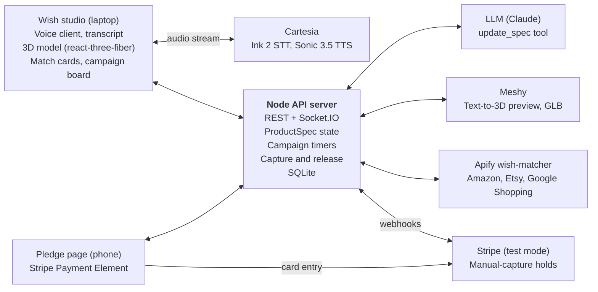
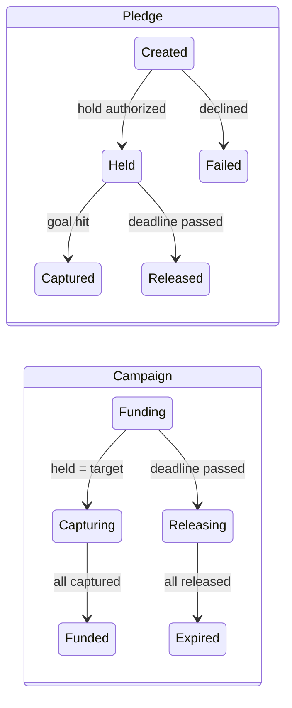
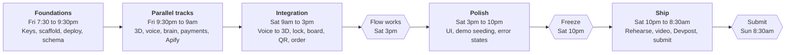

# Wish it: Cal Hacks 13.0 Build Plan

Oct 23, 2026 · @Aarnav

## TL;DR and decisions

Build one tight loop that always works live: speak a wish, watch a 3D model change as you talk, see Apify say "this doesn't exist yet," launch a campaign, and let a judge pledge from their phone with a card hold that captures the moment the goal is hit. Everything else is garnish. You have about 37 hours from Fri 7:15pm to the Sun 9:00am deadline; feature freeze is Sat 10:00pm.

| Open question | Decision | Why |
| --- | --- | --- |
| 3D render | **Hybrid.** A parametric Three.js garment model (women's clothing on a stylized mannequin, plus backpacks and helmets) appears in under 1 s and updates instantly from a JSON spec. A Meshy text-to-3D model generates in the background and morphs in through a sparkle transition when ready. | Parametric = zero latency and never fails on stage. Meshy = handles any wish, but takes about a minute, so it can't be on the critical path. |
| Cartesia | **Ink 2 (STT, streaming websocket with built-in turn detection) + Sonic 3.5 (TTS, streaming) called from our own web app.** Not Line. | Line is a Python platform built for deployed/phone agents. We need the voice loop inside a browser page driving a 3D canvas, which is simpler with the raw APIs. |
| Which LLM decides design changes | Claude (or Gemini) on our backend, with one tool: `update_spec(patch)`. It returns a short spoken reply plus a JSON patch. | The JSON patch drives the 3D model; the text goes to Sonic. One call per turn. |
| Apify | Build **our own Apify Actor**, `wish-matcher`, that calls existing Amazon / Etsy / Google Shopping actors in parallel, then scores matches with an LLM. Cache results. | Using Apify inside our app qualifies for the main Apify prize; publishing a custom Actor also makes us eligible for "Best Actor" ($400). |
| "Close enough" match | LLM judge scores each result 0 to 100 against the spec. 80+ = "exists," 50 to 79 = "close, but missing X," under 50 = ignore. | Lets the demo say something specific ("close, but no laptop stand") instead of a vague yes/no. |
| 7-day hold limit | Campaigns are capped at **6 days** in the product. For longer campaigns (future), backers save a card now and the hold is placed only in the final 6 days. Demo campaigns last minutes. | Matches the 7-day customer-initiated hold window with a day of safety margin. Gives a clean answer when judges ask. |
| What happens at goal | **Simulated maker.** Holds are captured for real (Stripe test mode), and an "order" goes to a maker that Apify found, shown as a generated purchase order. | Real payment mechanics, no fake manufacturing claims. |
| Stack | React + Vite, react-three-fiber, Node + Express, Socket.IO, SQLite, Stripe (test mode), deployed on one Render or Railway service over HTTPS. | Plays to your JavaScript strength; one language front and back; HTTPS is required for the mic. |
| Name | Keep **Wish it**. | Short, says the verb, works in the pitch. |

Team roles for a team of 4: A builds the UI, 3D and magic effects; B builds the voice loop and design brain; C builds payments, campaigns and the leaderboard; D builds the Apify Actor, deploy and demo seeding, and owns Devpost and the video.

## Product requirements

Wish it lets a shopper describe a product that doesn't exist, see it, and pool real demand for it with card holds, so it only gets made (and anyone only pays) if enough people commit.

### Users

- **Wisher:** has an idea for a product they'd buy ("a midi dress that turns into a skirt, with real pockets"). Wants to see it and find out if it exists.
- **Backer:** sees a wish on the board and wants it too. Wants zero risk: pay only if it actually gets made.
- **Maker (simulated for the hackathon):** receives a funded order with a spec, a 3D model, and a guaranteed number of buyers.

### Core flows

1. **Wish by voice.** Wisher taps the mic and describes the product. The app asks 2 to 3 short follow-ups (size, color, material, price they'd pay). Each answer updates the 3D model live.
2. **Spin and tweak.** Wisher can drag to rotate the model and keep talking ("make it emerald, and shorter").
3. **Does it exist?** On "lock it in," Apify searches marketplaces. Results show as cards with a match score. If something scores 80+, the app says "It exists, here it is" and links out.
4. **Launch a campaign.** If nothing matches, the wish becomes a campaign: target backers (e.g. 5), price per unit, deadline (max 6 days; minutes in the demo). A QR code links to the public campaign page.
5. **Pledge with a hold.** Backer opens the page on their phone, enters a card, and authorizes a hold. Their card shows a pending charge; nothing is captured yet.
6. **Goal hit.** The demand bar fills live on every screen. When the target is reached, all holds are captured and a purchase order goes to a maker found by Apify.
7. **Deadline missed.** All holds are released and backers see "Released, you were not charged."

### Success criteria (for the demo)

- Voice turn latency (user stops talking to first audio back): under 1.5 s typical.
- 3D render appears or changes within 1.5 s of the user finishing a sentence (target 1 s).
- Apify check returns in under 10 s live, or instantly from cache.
- A judge can pledge from their own phone in under 30 s via QR.
- Goal hit triggers capture of every hold, and the board updates on all screens within 2 s.
- A declined test card shows a clear error and does not count toward the goal.

### Non-goals (explicitly out of scope)

- Real manufacturing, shipping, or maker onboarding.
- User accounts and login (campaigns are public; backers enter only an email and card).
- Live-mode payments or real money.
- Photorealistic or manufacturable CAD. The model is a visual, not a spec sheet.
- Mobile app. Mobile web for the pledge page only.
- Image or sketch input (stretch only, if time remains Saturday).

## Experience requirements

The product must feel like making a wish: every spoken change answers within a second with something visible and a little magical, and nothing ever shows a spinner.

### Look and feel: playful and magical

- Bright, soft palette (lavender, mint, gold accents) on a deep twilight background so sparkles and bloom read well. Rounded glass panels, a friendly display font, generous spacing.
- The garment floats on a slowly turning pedestal with soft studio light and a faint glow underneath.
- Holds 60 fps on a laptop: one canvas, instanced particles, bloom via `@react-three/postprocessing`, no layout jank when panels update.
- Bar for quality: a teammate who didn't build it should say "whoa" on first load. Polish time (P1) is protected, not the first thing cut.

### 3D: instant first, AI upgrade second

1. As soon as the first utterance is processed, a swirl of particles assembles into the parametric garment (under 1 s from transcript to first frame).
2. Each voice change triggers a shimmer burst and a smooth 400 ms morph (color, length, sleeves), never a pop.
3. In parallel, Meshy generates a unique AI mesh. When ready, the parametric garment dissolves into particles that re-form as the AI model. This is the "novel" moment.
4. Clothing, backpacks and helmets (including headphone helmets) are the instant categories, so every example wish renders in under 1.5 s. Any other wish shows a glowing wish orb with orbiting sparkles until the AI mesh lands.

### Effects (all four)

| Moment | Effect |
| --- | --- |
| Generating | Particles swirl from the mic button and assemble into the product |
| Each voice change | Shimmer burst along the changed part, quick sparkle sound |
| Each pledge | A star flies from the pledge into the demand bar, which pulses |
| Goal hit | Full-screen celebration: confetti, golden glow, the product spins and "Wish granted" |

### Voice: a playful genie

- Personality: warm, witty, brief. Leans into the wish theme ("Your wish is taking shape...") without being cheesy. Max 2 short sentences per turn, one question at a time.
- Pick an expressive Sonic 3.5 voice and tune speed and emotion through `generation_config`. Test 3 voices with the team tonight.
- Feels natural: the model changes before the voice speaks, so the user sees the answer first; barge-in stops the genie mid-sentence; a soft sparkle hum plays while the brain is thinking.
- Lock in: after 2 to 3 turns the genie offers, "Shall I make your wish real?" A "yes" locks the spec. A glowing "Wish it" button is the silent backup.

### Apify: fast and cheap, still real

- **Speed vs accuracy:** live searches run only on lock-in, never per voice turn. Results stream in by store as each finishes. The demo wish is pre-warmed in the cache; any new wish runs live.
- **Credit cost:** cap 5 results per store, 3 stores, one LLM scoring call per lock. Cache by normalized query for 24 hours. A `DEMO_MODE` flag serves cache-only so rehearsals spend zero credits. Track run cost in the server log and check the Apify console each morning.

### Leaderboard (low priority)

- A "Most wished" board ranking campaigns by number of held pledges, live via `campaign:updated`.
- Built by C after payments work (Phase 2). First thing cut if Sat 3pm slips.

## Screens

Three screens, based on the team's sketches: talk to the orb, see your product next to what already exists, then track every wish in one place.

```text
1. Voice                    2. Results                  3. Wishlist
+------------------------+  +------------------------+  +------------------------+
|Wish it       (wishlist)|  |                  (save)|  |[My wishes][Most wished]|
|                        |  |    .--------------.    |  |[img] Pocket midi dress |
|    .--------------.    |  |   (    3D render   )   |  |      [#########---]    |
|   (  Sparkle orb   )   |  |   (   spin to view )   |  |[img] Headphone helmet  |
|   ( becomes the 3D )   |  |    '--------------'    |  |      [######------]    |
|   (     render     )   |  |+----------++----------+|  |[img] Stand-up backpack |
|    '--------------'    |  || Match 1  || Match 2  ||  |      [###---------]    |
|                        |  ||from Apify||score, $  ||  |- - - - - - - - - - - - |
|( Backpack + lap stand )|  |+----------++----------+|  |     Your next wish     |
|( Helmet + headphones  )|  || Match 3  || Match 4  ||  |- - - - - - - - - - - - |
|( Dress that's a skirt )|  |+----------++----------+|  |                        |
|     Live captions      |  |                        |  |  Bars = live demand    |
|   (o)    (MIC)    (o)  |  |[Wish it into existence]|  |                        |
+------------------------+  +------------------------+  +------------------------+
```

*Talk to the orb, compare with what exists, then track your wishes.*

The orb on screen 1 becomes the render on screen 2 in place, so the product appears exactly where you were looking.

### 1. Voice screen (the wish)

Should feel like ChatGPT or Claude voice mode: one big living orb, almost no chrome, and you just talk.

- **Center:** a sparkle orb that reacts to sound. Idle: breathes slowly. Listening: ripples with your mic volume. Thinking: sparkles swirl inward. Speaking: pulses with the genie's voice.
- **The magic moment:** when the first wish is understood, the orb bursts into particles that assemble into the 3D product in the same spot. No page change, no loading screen.
- **Examples under the orb** (tap or just say one): "a backpack with a built-in laptop stand," "a bike helmet with built-in headphones," "a midi dress that turns into a skirt." They cycle gently while idle.
- **Bottom:** live captions of both you and the genie (fade after a few seconds), and three controls like voice mode: mute, type instead, end. The genie's voice can be switched from a small voice picker.
- **Top:** Wish it logo left, wishlist (heart) right.
- Interrupt any time; the genie stops instantly.

### 2. Results screen (does it exist?)

- **Top center:** the 3D render, still spinnable, still voice-editable ("actually make it black" keeps working here).
- **2x2 grid:** four closest real products from Apify, each with photo, store, price, match score, and what it's missing ("no headphones"). Cards stream in as each store returns.
- **Heart, top right:** saves the wish to the wishlist.
- **Bottom CTA:** if nothing scores 80+, a glowing "Wish it into existence" button launches the campaign. If something does, the top card gets a "This exists" badge and a buy link.

### 3. Wishlist

- **My wishes tab:** every hearted or launched wish, with thumbnail, status (saved, funding, funded, released), and a live demand bar. Tap opens the campaign page with its QR code.
- **Most wished tab:** the leaderboard, ranked by held pledges (low priority; cut first).

### Speed budget: under 1.5 s from end of speech to render

| Stage | Target | How |
| --- | --- | --- |
| End-of-turn detection | 300 ms | Ink 2 built-in turn detection; tune its sensitivity tonight |
| Instant guess | 0 ms extra | While you're still talking, a small keyword matcher on live (interim) captions picks category and color, so particles start forming early |
| Design brain | 600 ms | Fastest model available, tiny tool schema, streamed; apply the patch as soon as the tool arguments parse |
| Render | 100 ms | Patch goes over the socket; parametric model morphs, no network fetch |
| Total | about 1.0 s | Genie's voice starts after the render, so you always see the answer first |

Measure every turn in the server log (transcript received to patch emitted) and show it on a hidden debug overlay during testing.

## Technical spec

One Node server owns all secrets and state; the React app talks to it over REST plus Socket.IO, and to Cartesia directly using a short-lived access token.

### Components

| Component | Tech | Responsibility |
| --- | --- | --- |
| Web app | React + Vite, react-three-fiber, drei | Wish studio (mic, transcript, 3D canvas, match cards), campaign board, pledge page |
| Voice client | Cartesia JS SDK (`@cartesia/cartesia-js`) | Mic to Ink 2 STT websocket; plays Sonic 3.5 TTS stream; barge-in |
| API server | Node + Express + Socket.IO | Turn handling, spec state, Apify and Meshy jobs, Stripe, campaign logic, timers |
| Design brain | Claude API (or Gemini) with tool calling | Turns each user utterance into a spoken reply plus a spec patch |
| 3D | Parametric r3f components per category; Meshy GLB loaded with `useGLTF` | Instant model updates; hero model when ready |
| Match finder | Custom Apify Actor `wish-matcher` (Node) | Searches marketplaces, normalizes, scores |
| Payments | Stripe test mode, PaymentIntents with `capture_method: 'manual'`, Payment Element | Holds, capture, release, webhooks |
| Storage | SQLite (better-sqlite3) | Wishes, matches, campaigns, pledges, Apify cache |



*The server holds every key; browsers go direct only to Cartesia and Stripe.*

Only voice audio (Cartesia) and card entry (Stripe Payment Element) go straight from the browser; everything else goes through the server, which keeps all API keys.

### The voice loop (one turn)

1. Browser streams mic audio (16 kHz PCM via AudioWorklet) to Cartesia STT over websocket, model `ink-2`.
2. Ink 2 emits `turn.end` when the user stops talking. Browser sends the final transcript to `POST /api/wish/:id/turn`.
3. Server calls the LLM with the current spec, recent transcript, and one tool, `update_spec(patch)`. The model must return a short reply (max 2 sentences, ends with at most one question) and a patch.
4. Server applies the patch, emits `spec:updated` over Socket.IO (3D updates now, before audio starts), and returns `{ say, spec }`.
5. Browser sends `say` to Sonic 3.5 over websocket and plays the stream. If Ink 2 fires `turn.start` while audio plays, stop playback (barge-in).
6. Fallbacks always visible: push-to-talk button and a text box that hits the same endpoint.

Implementation notes for Claude Code: tell it to fetch `https://docs.cartesia.ai/llms.txt` before writing Cartesia code, send the `Cartesia-Version` header on every request, use API keys only server-side, and mint a browser access token from a server route. Do not use Cartesia Line for this project.

### ProductSpec (the single source of truth)

```json
{
  "category": "dress | top | skirt | backpack | helmet | generic",
  "name": "Convertible Pocket Midi",
  "length": "mini | knee | midi | maxi",
  "silhouette": "fitted | a_line | wrap | flowy",
  "sleeves": "none | cap | short | long",
  "neckline": "crew | v | square | halter",
  "color": "#1F8A5B",
  "fabric": "cotton | satin | linen | knit",
  "pattern": "solid | floral | stripe",
  "features": ["phone_pockets", "converts_to_skirt"],
  "target_price_usd": 79,
  "notes": "bodice detaches at the waist"
}
```

The garment is built from a few parametric pieces on a stylized mannequin: a lathe-generated skirt whose radius curve comes from `silhouette` and `length`, a bodice, and sleeve tubes. Fabric sets the material (`MeshPhysicalMaterial` with `sheen` for satin and knit, roughness for linen and cotton), and each known feature toggles a sub-mesh (e.g. `phone_pockets` = visible pocket panels; `converts_to_skirt` = a glowing seam at the waist that animates apart). Anything that isn't clothing renders a soft glowing "wish orb" while Meshy generates.

### Meshy hero model

- `POST https://api.meshy.ai/openapi/v2/text-to-3d` with `{ mode: "preview", prompt, should_remesh: true }` returns a task id.
- Poll `GET /openapi/v2/text-to-3d/{id}` every 5 s until `status: SUCCEEDED`, then read `model_urls.glb`.
- Server downloads the GLB and serves it from `/models/:wishId.glb` (avoids CORS and expiring URLs).
- Develop with Meshy's free test-mode key; pre-generate and cache the GLB for the demo wish.

### Apify: `wish-matcher` Actor

- Input: `{ query, spec, sources: ["amazon", "etsy", "google_shopping"], maxPerSource: 10 }`.
- Inside: calls one existing Store actor per source in parallel (pick and test tonight; there are several Amazon, Etsy and Google Shopping scrapers), with a 25 s timeout each. Normalizes to `{ source, title, url, price, image }`.
- Scores each result with an LLM against the spec: `{ score: 0-100, missing: ["laptop stand"] }`. Pushes the top 6 to the dataset.
- Our server calls it with `POST https://api.apify.com/v2/acts/<username>~wish-matcher/run-sync-get-dataset-items?token=...`.
- Results are cached in SQLite by a hash of the normalized query. The demo wish is pre-warmed.
- Stretch mode `findMakers`: searches for manufacturers of the category and returns 3 candidate makers for the purchase order.

### REST and socket API

| Method | Path | Purpose |
| --- | --- | --- |
| POST | `/api/wish` | Create a wish, returns id and empty spec |
| POST | `/api/wish/:id/turn` | Send a transcript turn; returns `{ say, spec }` |
| POST | `/api/wish/:id/lock` | Freeze spec, start Meshy job and Apify check |
| GET | `/api/wish/:id/matches` | Match results (from cache or Apify) |
| POST | `/api/campaigns` | Launch campaign from a wish: price, target, deadline |
| GET | `/api/campaigns/:id` | Campaign page data |
| POST | `/api/campaigns/:id/pledges` | Create a manual-capture PaymentIntent; returns `client_secret` |
| POST | `/api/stripe/webhook` | Stripe events (source of truth for pledge state) |
| GET | `/api/cartesia/token` | Short-lived Cartesia access token for the browser |
| POST | `/api/admin/campaigns/:id/expire` | Demo button: force the deadline now |
| socket | `spec:updated`, `meshy:ready`, `matches:ready`, `campaign:updated` | Live updates to every open screen |

### Data model (SQLite)

| Table | Key columns |
| --- | --- |
| wishes | id, spec_json, transcript_json, meshy_task_id, model_path, status (drafting, locked) |
| matches | wish_id, source, title, url, price, image, score, missing_json |
| campaigns | id, wish_id, price_cents, target_backers, deadline_at, status, maker_json |
| pledges | id, campaign_id, email, payment_intent_id, status, created_at |
| apify_cache | query_hash, results_json, fetched_at |

### Payment state machine

A pledge only counts toward the goal once Stripe confirms the hold via webhook, and the campaign flips to capturing exactly once.



*A pledge counts only once Stripe confirms the hold. Capturing calls capture on every held pledge; Releasing calls cancel. Webhooks confirm each state.*

The campaign's flip from Funding to Capturing is the one moment that must happen exactly once; it drives every pledge from Held to Captured.

- **Create hold:** `stripe.paymentIntents.create({ amount, currency: 'usd', capture_method: 'manual', metadata: { campaignId, pledgeId } })`. Client confirms with the Payment Element and `stripe.confirmPayment({ elements, redirect: 'if_required' })`.
- **Held:** webhook `payment_intent.amount_capturable_updated` (status `requires_capture`). Increment the count; emit `campaign:updated`.
- **Failed:** webhook `payment_intent.payment_failed`. Show the decline reason; not counted.
- **Goal hit:** inside one SQLite transaction, check `held >= target` and set campaign `funding` to `capturing`. Only the request that wins this flip runs capture. Then `stripe.paymentIntents.capture(id)` for each held pledge with idempotency key `capture-<pledgeId>`. New pledges are rejected once capturing starts.
- **Captured:** webhook `payment_intent.succeeded`. When all are settled, campaign becomes `funded` and the purchase order is generated.
- **Deadline:** a server timer (checked every 5 s, and on boot) sets `releasing` and calls `stripe.paymentIntents.cancel(id)` for each held pledge. Webhook `payment_intent.canceled` marks them `released`. Campaign becomes `expired`.
- **Capture failure** (e.g. hold expired): mark that pledge `capture_failed`, keep going, show it on the board.

Test cards: `4242 4242 4242 4242` succeeds, `4000 0000 0000 0002` is a generic decline, `4000 0000 0000 9995` is insufficient funds. Run webhooks locally with `stripe listen --forward-to localhost:3000/api/stripe/webhook`.

### Error handling

| Failure | What the user sees | Behavior |
| --- | --- | --- |
| STT socket drops | "Mic reconnecting" chip | Auto-reconnect once; text box stays usable |
| LLM returns invalid patch | Nothing breaks | Validate with zod; drop invalid fields; reply still spoken |
| TTS fails | Reply shown as text | Continue without audio |
| Meshy slow or fails | Parametric model stays | Hero swap is optional; never block the flow |
| Apify timeout | "Searched 2 of 3 stores" | Return partial results; use cache when present |
| Card declined | Decline reason on pledge page | Pledge marked failed; bar unchanged |
| Duplicate webhook | Nothing | Handlers are idempotent by `payment_intent_id` and status |
| Server restart | Nothing | State lives in SQLite; deadline timers rebuilt on boot |

## Demo script

The pitch is built around one moment: a judge pledges from their own phone and their pledge is the one that funds the product. Rehearse it until it runs in 2:50.

### Setup before you walk up

- Laptop on the Wish studio, mic tested, volume up. Phone hotspot ready as backup Wi-Fi.
- Demo wish's Apify results and Meshy GLB pre-cached.
- A second campaign ("Self-watering desk planter") pre-launched with 2 of 4 backers and a deadline about 2 minutes out, for the release beat.
- Stripe dashboard open in a background tab, filtered to test mode.
- Teammate's phone ready with the decline card `4000 0000 0000 0002`.

### 3-minute pitch

| Time | Who / what | Say or do | Criterion it hits |
| --- | --- | --- | --- |
| 0:00 to 0:20 | Speaker 1, talking | "Every shopping app assumes the thing you want already exists. But everyone has said 'I wish someone made...' Wish it lets you shop for products that don't exist yet, and only pay if they get made." | Application, Creativity |
| 0:20 to 1:05 | Speaker 2, live voice | Says: "I want a midi dress that turns into a skirt, with pockets that actually fit my phone." App asks about size and color. Says "emerald green, and a little shorter." Model changes on each answer; spin it. | Intentionality, Technical complexity |
| 1:05 to 1:25 | Live | "Lock it in." Apify cards appear: "Closest match scores 62: a convertible dress, but no phone-sized pockets." Hero Meshy model swaps in. | Functionality, Apify |
| 1:25 to 2:15 | Live, judge's phone | Launch: $89, target 3 backers. Show QR. Teammate pledges with the decline card: clear error, bar doesn't move. Teammate pledges with 4242: bar at 2/3. Hand the QR to a judge: their pledge hits 3/3, holds capture, purchase order to a maker appears. | Functionality, Visa |
| 2:15 to 2:40 | Speaker 1 | Switch to the planter campaign as its deadline passes: "Missed the goal, every hold released, nobody paid." "Card holds turn a payment feature into a commitment primitive: real demand, zero risk to backers." | Visa, Application |
| 2:40 to 3:00 | Speaker 1 | "Kickstarter starts from the maker. Wish it starts from the shopper's imagination. Built on Visa holds, Apify, and Cartesia." | Close |

### Judge Q&A prep

- **"Holds expire after 7 days."** Campaigns are capped at 6 days. Longer campaigns would save the card and place holds only in the final 6 days.
- **"Who actually makes it?"** Apify finds candidate makers; the funded order goes to them with the spec, model, and guaranteed buyers. For the hackathon the maker is simulated; the payments are real (test mode).
- **"Why not just upvotes?"** Upvotes are free and lie. A hold costs the backer nothing unless it ships, but proves they'd pay.
- **"What if one capture fails?"** It's marked capture_failed and shown; the rest proceed. Production would set a buffer above the target.
- **"How does the voice change the model?"** Each turn, the LLM returns a reply plus a JSON patch to the product spec; the patch drives the 3D model before the audio even starts.

### Devpost video (2:30 max)

Record the same flow Saturday night with screen capture plus a phone filming the pledge. Add captions. Cut in one 5-second shot of the Stripe dashboard showing pledges move from "uncaptured" to "succeeded," and one of the planter's holds being canceled. Sponsors judging asynchronously should be able to follow it with the sound off.

## Build plan for Claude Code

Three sequential setup steps tonight, then three people run Claude Code in parallel on separate branches until the full flow works end to end by Sat 3:00pm.



*The full flow must work by Sat 3pm; submit by 8:30am Sunday.*

If the Sat 3pm gate slips, everything after it shrinks; Phase 1 is where the hours are.

**How to run it:** save each step below as its own prompt file (`docs/steps/01-scaffold.md`, and so on) containing the step, the relevant section of this spec, and its "done when" test. Give Claude Code one step at a time. Parallel steps run in separate git worktrees or branches and merge through `main`. Commit after every step that passes its test.

### Phase 0: foundations (Fri 7:30pm to 9:30pm, in order)

| # | Step | Owner | Done when |
| --- | --- | --- | --- |
| 0.1 | Get keys: Stripe test, Cartesia, Apify, Meshy, Anthropic. Visit Visa, Apify, Cartesia booths to confirm judging criteria. | All | All keys in a shared `.env`; booth notes posted in team chat |
| 0.2 | Scaffold monorepo: `web/` (Vite React + r3f), `server/` (Express + Socket.IO + SQLite), `actor/` (Apify), `shared/`. Deploy a hello-world to Render with HTTPS. | C | Deployed URL loads and a socket ping round-trips |
| 0.3 | Write `shared/spec.ts`: ProductSpec zod schema, socket event names, API types. | B | Both web and server import it and build |

### Phase 1: parallel tracks (Fri 9:30pm to Sat 9:00am, sleep in shifts)

| # | Step | Owner | Runs in parallel with | Done when |
| --- | --- | --- | --- | --- |
| A1 | Parametric 3D: dress, top, skirt on a stylized mannequin, plus backpack and helmet (with optional headphone cups), plus a generic wish orb. Spec drives length, silhouette, sleeves, neckline, color, fabric, pockets; particle build-in and shimmer effects; orbit controls. | A | B1, B2, C1, C2 | Editing spec JSON in a debug panel visibly changes the model in under 1 s |
| B1 | Voice client: `/api/cartesia/token`, mic to Ink 2 STT, live transcript, Sonic 3.5 playback, barge-in, text-box fallback. | B | A1, C1, C2 | Speak a sentence, see transcript, hear an echoed reply in under 1.5 s |
| B2 | Design brain: `/api/wish/:id/turn` with LLM tool `update_spec`, zod validation, system prompt that asks at most one question per turn. | B | A1, C1, C2 | 5 scripted utterances produce valid patches and short replies |
| C1 | Payments: tables, pledge PaymentIntent (manual capture), mobile pledge page with Payment Element, webhooks, capture on goal, release on deadline, admin expire button. | C | A1, B1, C2 | 3 test pledges capture; an expired campaign's holds show canceled in Stripe |
| C2 | Apify `wish-matcher` Actor: pick 3 Store actors, normalize, LLM scoring, publish to Apify Store; server call plus SQLite cache. | D | A1, B1, C1 | Demo query returns scored results in under 25 s live, instantly cached |

### Phase 2: integration (Sat 9:00am to 3:00pm)

| # | Step | Owner | Depends on | Done when |
| --- | --- | --- | --- | --- |
| I1 | Wire voice turns to spec to 3D via `spec:updated`. | A + B | A1, B1, B2 | Speaking "make it green" turns the model green |
| I2 | Lock flow: start Meshy job, call Apify, render match cards, swap in hero GLB on `meshy:ready`. | A + C | A1, C2 | Lock shows matches and hero model with no page reload |
| I3 | Campaign launch, public board, QR code, live demand bar via `campaign:updated`. | A + C | C1 | Pledge on phone updates the laptop bar within 2 s |
| I4 | Purchase order view when funded (spec, model thumbnail, maker, backer count, total captured). | C | C1, C2 | Goal hit shows the order screen |

**Milestone Sat 3:00pm:** full demo flow works on the deployed URL. If it doesn't, cut stretch work and fix only this.

### Phase 3: polish and resilience (Sat 3:00pm to 10:00pm)

| # | Step | Owner | Done when |
| --- | --- | --- | --- |
| P1 | UI polish: studio look, transitions, empty states, mobile pledge page. | A | Teammates who didn't build it can do the flow without help |
| P2 | Demo seeding script: pre-warm Apify cache, pre-generate GLB, create the planter campaign with 2 backers and a configurable deadline. | C | One command resets the demo to its starting state |
| P3 | Implement every row of the error-handling table. | B | Each failure is forced once and handled |
| P4 | Stretch, only if P1 to P3 are done: Apify `findMakers`, sketch or photo input, focus mode (zoom into a part, exploded view, direct handles; nice to have). | Whoever is free | Works in the demo, or is cut |

**Feature freeze Sat 10:00pm.** After this, only bug fixes.

### Phase 4: ship (Sat 10:00pm to Sun 8:30am)

- Sat 10pm to midnight: rehearse the pitch 5 times; record the Devpost video.
- Midnight to 1am: Devpost draft (text, image, repo link, video), README, Apify Actor listing text, opt-ins for MLH extras.
- Sun 6:00am: wake, run the reset script, one rehearsal.
- **Be checked in at the venue by 8:00am.** Submit on Devpost by 8:30am, 30 minutes before the 9:00am hard deadline, with all teammates added.

## Risks and fallbacks

The biggest risk is venue Wi-Fi during the live demo; every network-dependent step has a cached or offline fallback that looks identical on stage.

| Risk | Likelihood | Fallback | Owner |
| --- | --- | --- | --- |
| Venue Wi-Fi is slow or drops | High | Phone hotspot; all demo assets (Apify results, GLB) pre-cached on the server | All |
| Voice latency feels slow (over 2 s) | Medium | Keep LLM replies to 1 to 2 sentences; use a fast model; show the 3D change before audio; push-to-talk if turn detection misfires | B |
| Noisy room breaks STT | High | Lapel or headset mic; push-to-talk; text box always visible | B |
| Meshy takes too long or looks bad | High | Parametric model is the main visual; hero swap is optional; pre-generated GLB for the demo wish | A |
| Apify run is slow or a Store actor breaks | Medium | 25 s timeout per source, partial results, SQLite cache, pre-warmed demo query | C |
| Apify finds an exact match for the demo wish | Medium | Test the demo wish tonight; pick a wish that scores under 80. Also good: show one wish that does exist ("it already exists, here it is") | C |
| Stripe webhook doesn't reach the server | Low on Render, high on localhost | Deploy early; verify webhook delivery in Stripe dashboard; fallback poll of PaymentIntent status every 3 s on the pledge page | C |
| Two pledges hit the goal at once | Low | Atomic SQLite transaction on the campaign status flip; idempotency keys on capture | C |
| Judge's phone can't scan or load | Medium | Teammate's phone as backup backer; short URL printed under the QR | C |
| Integration slips past Sat 3pm | Medium | Cut P4 stretch; cut tops and skirts (dresses only); pre-record the voice section for the video | All |
| Track rules differ from what we assume | Medium | Booth visits in step 0.1; adjust which feature leads the pitch | All |

## Submission checklist

- [ ] Devpost project created early Saturday and all teammates added
- [ ] Tracks selected: Visa Reimagining Shopping, Apify, Cartesia
- [ ] Apify `wish-matcher` published in the Apify Store (for Best Actor) and linked on Devpost
- [ ] MLH Commit Fellowship opt-in form; GoDaddy domain claimed and pointed at the deploy
- [ ] Project image (studio screenshot with the emerald dress and demand bar)
- [ ] Public GitHub repo with README: what it is, how to run, architecture, sponsor tools used
- [ ] Devpost video under 2:30, captioned, shows holds captured and released in Stripe
- [ ] Devpost text explains the Visa angle (holds as commitment), Apify use, and Cartesia voice loop in one paragraph each
- [ ] Demo reset script tested Sunday morning
- [ ] Checked in at the venue by 8:00am Sunday
- [ ] Submitted by 8:30am Sunday (deadline 9:00am)

## Sources

- [Cartesia docs: API and Line overview](https://docs.cartesia.ai/skill.md)
- [Cartesia agent guide (Line vs direct API)](https://docs.cartesia.ai/tools/ai/agent-guide)
- [Cartesia changelog: Ink 2 with turn detection](https://docs.cartesia.ai/changelog)
- [Meshy API quick start: text-to-3D preview and refine](https://docs.meshy.ai/ru/api/quick-start)
- [Apify Etsy scraper API example (run-sync-get-dataset-items)](https://apify.com/h4sh/etsy-scraper/api)
- [Cal Hacks 13.0 Devpost](https://cal-hacks-13-0.devpost.com)

---

*Source: [Wish it: Cal Hacks 13.0 Build Plan](https://claude.ai/artifact/Nrq8m2YjCQc16Wag2Pj8oV) (rev 31). Diagrams converted to Mermaid/ASCII for GitHub.*
